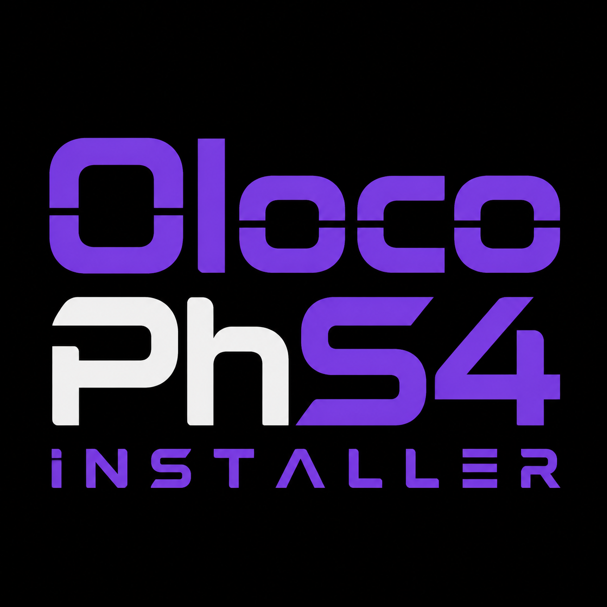

<p align="center">
  
</p>

# OlocoPhS4 Installer

Aplicativo para Windows que envia arquivos `.pkg` armazenados no computador para um PlayStation 4 com GoldHEN pela rede local.

> **Projeto em fase de testes.** Ainda podem ocorrer erros e incompatibilidades. Novos ajustes, correções e melhorias serão adicionados em versões futuras.

## Autoria

O OlocoPhS4 Installer foi desenvolvido por brasileiro, que no caso sou **eu mesmo**, sou estudante de **Desenvolvimento de Sistemas (DS)**, e com auxílio de ferramentas de Inteligência Artificial durante o desenvolvimento, os testes e a documentação.

O projeto utiliza como base o [DirectPackageInstaller](https://github.com/marcussacana/DirectPackageInstaller), de marcussacana, e mantém os créditos e a licença do projeto original.

## Baixar o programa

1. Acesse a página de [Releases](https://github.com/Ophlc/OlocoPhS4/releases/latest).
2. Abra a versão mais recente.
3. Na seção **Assets**, baixe o arquivo `OlocoPhS4-Installer-0.2.zip`.
4. Quando o download terminar, extraia todo o conteúdo do ZIP para uma pasta.
5. Dentro da pasta extraída, entre na pasta **Arquivo do programa**.
6. Execute como administrador o arquivo **OlocoPhS4 Installer**. 
7. Não apague nem mova a pasta **Arquivos do programa**, pois ela contém os componentes necessários para executar o aplicativo.

O executável disponibilizado nesta versão é destinado ao **Windows 64 bits**.

## Recursos da versão 0.2.0

- Interface própria nas cores preto e roxo.
- Fluxo visual para conexão, seleção do pacote e instalação.
- Diálogos e ícone personalizados do OlocoPhS4 Installer.
- Seleção e leitura de arquivos PKG locais.
- Leitura de título, Title ID, Content ID, versão exigida e ícone do pacote.
- Detecção do IP local do computador.
- Servidor HTTP local para o PS4 obter o arquivo sem uma cópia FTP prévia.
- Exibição do volume transferido, percentual e velocidade.
- Persistência dos IPs e das configurações locais.
- Mensagens de diagnóstico para problemas de conexão com o BinLoader.

## Requisitos

- Windows 64 bits.
- PlayStation 4 com GoldHEN carregado.
- BinLoader ou Payload Server ativado no PS4.
- Computador e PS4 conectados à mesma rede local.
- Espaço livre suficiente no armazenamento do PS4.
- Um arquivo `.pkg` próprio ou que você tenha autorização para utilizar.

## Sobre o GoldHEN

O [GoldHEN](https://github.com/GoldHEN/GoldHEN) é um Homebrew Enabler para PlayStation 4. Entre suas funcionalidades estão suporte a homebrews, instalação remota de pacotes, servidor FTP e BinLoader.

O OlocoPhS4 Installer utiliza o **BinLoader/Payload Server** do GoldHEN para iniciar o processo de instalação. Normalmente, o BinLoader utiliza a porta `9090`; o aplicativo também tenta as portas `9021` e `9020` para compatibilidade.

Para conhecer versões compatíveis, novidades, avisos e limitações, consulte o [repositório oficial](https://github.com/GoldHEN/GoldHEN) e as [Releases oficiais do GoldHEN](https://github.com/GoldHEN/GoldHEN/releases).

Este projeto não é afiliado, mantido ou endossado pela equipe do GoldHEN. O GoldHEN não acompanha o download do OlocoPhS4 Installer.

## Como usar

1. Conecte o computador e o PS4 à mesma rede.
2. Carregue o GoldHEN no PS4.
3. Ative o **BinLoader** ou **Payload Server** nas configurações do GoldHEN.
4. Execute como administrador o arquivo **OlocoPhS4 Installer** no computador.
5. Informe o IP do PS4 e confira o IP detectado para o computador.
6. Use **Testar acesso ao PS4** para verificar a comunicação básica.
7. Selecione o arquivo `.pkg` armazenado no computador.
8. Confira as informações detectadas e clique em **Instalar no PS4**.
9. Mantenha o aplicativo e o computador ligados até o PS4 terminar de obter o arquivo.

O teste de acesso verifica a rede, mas não garante sozinho que o BinLoader está ativo. Caso necessário, desative e ative novamente o BinLoader antes de repetir uma instalação.

## Erros ao instalar ou abrir um jogo

O aplicativo pode funcionar normalmente com alguns pacotes e falhar com outros. Nesses casos, o problema pode estar no próprio arquivo `.pkg`, por exemplo:

- download incompleto ou arquivo corrompido;
- pacote incompatível com a versão do firmware do PS4;
- pacote que exige atualização ou backport adequado;
- base, atualização e DLC pertencentes a regiões ou Title IDs diferentes;
- dump ou empacotamento criado incorretamente.

Se o envio falhar somente com um jogo, ou se o jogo instalar e apresentar erro ao abrir, experimente obter novamente o arquivo por outro link ou site **confiável e legalmente autorizado**. Dê preferência a uma nova cópia de seu próprio backup ou a conteúdo que você tenha direito de utilizar.

O OlocoPhS4 Installer não hospeda, fornece ou indica downloads de jogos e arquivos PKG protegidos por direitos autorais.

## Compilação

Requisitos de desenvolvimento:

- SDK .NET 8 ou versão mais recente compatível.
- Windows x64 para gerar o pacote distribuído nesta versão.

```powershell
dotnet restore .\DirectPackageInstaller\DirectPackageInstaller.Desktop\DirectPackageInstaller.Desktop.csproj
dotnet build .\DirectPackageInstaller\DirectPackageInstaller.Desktop\DirectPackageInstaller.Desktop.csproj -c Release --no-restore
```

Para gerar uma publicação autossuficiente:

```powershell
dotnet publish .\DirectPackageInstaller\DirectPackageInstaller.Desktop\DirectPackageInstaller.Desktop.csproj -c Release -r win-x64 --self-contained true
```

## Créditos e licença

O OlocoPhS4 Installer é derivado do [DirectPackageInstaller](https://github.com/marcussacana/DirectPackageInstaller), distribuído sob a GNU General Public License v3.0. O projeto também utiliza componentes originados de LibOrbisPkg, HttpServerLite e outros projetos creditados pela base original.

Este projeto derivado é distribuído sob a licença [GNU GPL-3.0](LICENSE).
